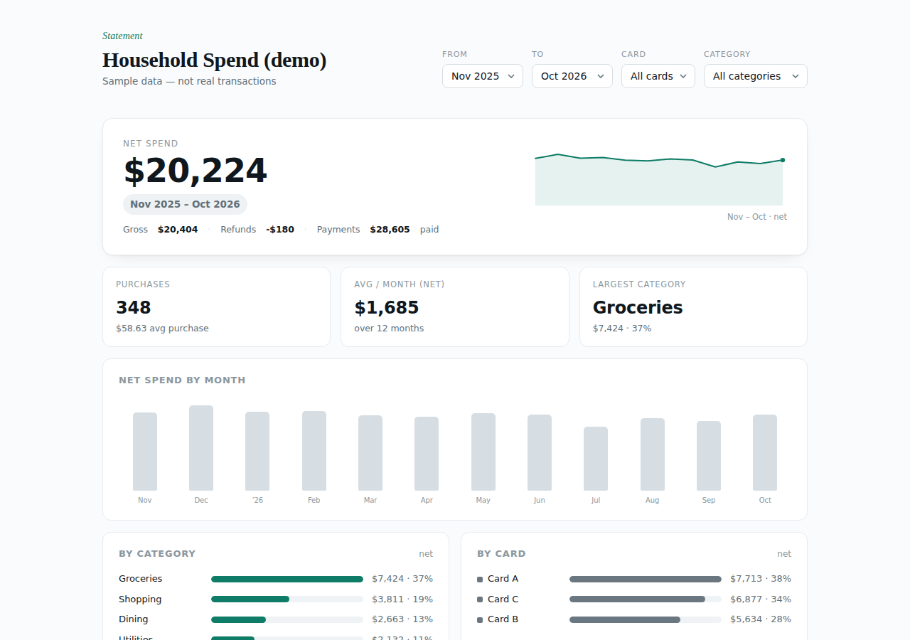
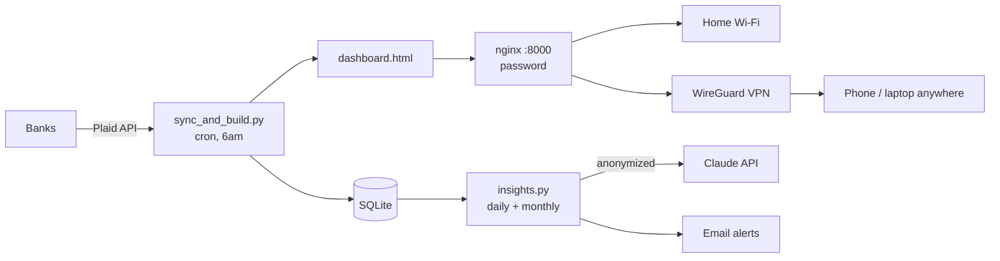

# Pi Finance Dashboard

A private, self-hosted household spending dashboard that runs on a Raspberry Pi.
It pulls credit-card transactions through Plaid every morning, serves a clean
single-page dashboard on your home network, and is reachable from anywhere over
your own WireGuard VPN. No cloud database and no subscription service hold your data.

Optional: AI insights with Claude. A daily email flags new or cancelled
subscriptions and unusual charges, and a monthly email summarizes spending by
category. Only anonymized transactions are sent to the model.



**[Open the live demo with fake data →](docs/demo.html)** (download and open locally, or enable GitHub Pages)

## Features

- **One-page dashboard:** net spend, refunds and card payments tracked separately, spend by category, card and month, top merchants, filters, and a transaction table. It's a single self-contained HTML file that works offline.
- **Daily sync:** incremental Plaid `/transactions/sync` with per-account cursors, stored in SQLite.
- **Private remote access:** a self-hosted WireGuard VPN. Only one UDP port is forwarded, and the dashboard itself is never exposed to the internet.
- **Self-healing address:** a DuckDNS updater on the Pi keeps a hostname pointed at your changing home IP.
- **AI insights (optional):** daily alerts and a monthly summary from the Claude API, sent by email.

## How it works



## Requirements

- Raspberry Pi 4 or newer running Raspberry Pi OS, on wired Ethernet
- A free [Plaid](https://plaid.com) account. The Trial plan allows up to 10 bank connections.
- A router where you can forward one UDP port (for remote access)
- Optional: an Anthropic API key and a Gmail App Password (for AI insights)

## Setup

Clone the repo onto the Pi and run the numbered scripts in order. Each one
prints any manual step it needs from you. See [`setup/README.md`](setup/README.md)
for details.

```bash
git clone https://github.com/<you>/pi-finance-dashboard.git
cd pi-finance-dashboard
bash setup/01_install.sh      # nginx + Python venv
bash setup/02_configure.sh    # Plaid keys + dashboard password -> .env
bash setup/preflight.sh       # checks your keys without using a Plaid connection
bash setup/03_webserver.sh    # nginx on :8000
bash setup/04_link_cards.sh   # link banks in a browser (via SSH tunnel)
bash setup/05_sync_now.sh     # first sync + dashboard
bash setup/06_schedule.sh     # daily 6am sync
bash setup/09_duckdns.sh      # optional: dynamic DNS name
bash setup/07_wireguard.sh    # optional: VPN + phone QR code
bash setup/10_insights.sh     # optional: AI insights emails
```

To preview the dashboard without any accounts, run `python demo.py`, which writes `docs/demo.html`.

## Privacy & security

- Bank passwords are entered only on the bank's own login page inside Plaid Link. This app never sees them.
- Plaid access tokens stay on the Pi in an owner-only file. `.env`, tokens, and the database are listed in `.gitignore`.
- The dashboard sits behind an nginx password and is reachable only from your LAN or WireGuard VPN.
- AI insights send only the date, a scrubbed merchant name, amount, category, a card letter (A/B/C), and whether it's a spend or refund. Account and transaction IDs, card numbers, bank names, payments, and locations never leave the Pi.

## Costs

- Plaid Trial: free for up to 10 connections. Link each bank only once, because removed connections still count toward the limit.
- Claude API: usage-based and billed separately from a Claude subscription. Set `INSIGHTS_MODEL` to a smaller model to lower costs.

## Disclaimer

This is a personal project, not financial advice. It is not affiliated with Plaid,
Anthropic, or any bank. Use it at your own risk.

## License

MIT
